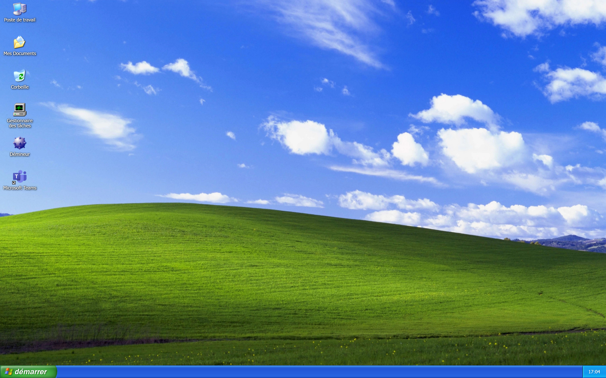

[Français](README.md) · **English**

# Mid-2000 PC

A 2004 PC running Windows XP, recreated in the browser: the BIOS doing its
POST, the Windows XP boot screen, the welcome screen, then a full desktop with
its windows, taskbar and Start menu.

**Live demo: [https://mid-2000-pc.douay.me/](https://mid-2000-pc.douay.me/)**



## Features

- **Full boot sequence**: BIOS screen with POST and memory test (beep
  included), Windows XP boot screen, logon screen, welcome screen with the
  startup sound.
- **BIOS Setup**: reachable with the `Del` key during POST, keyboard-driven.
- **Windows XP desktop**: icons, wallpaper, taskbar, Start menu, movable and
  resizable windows (minimize / maximize / close), and a Run dialog that
  launches every application by name (`notepad`, `taskmgr`, `winmine`,
  `nusrmgr.cpl`...).
- **Explorer**: My Computer, folder navigation, several view modes, create /
  rename / delete / copy-paste, a Recycle Bin you can restore from or empty,
  all on a virtual file system kept in the browser.
- **Notepad**: opens and saves the text files of that file system.
- **Minesweeper**: the classic game, faithful to the original.
- **Task Manager**: applications, processes, performance, and an animated
  icon in the notification area.
- **User Accounts**: create and edit the accounts offered on the logon screen.
- **Session and shutdown**: log off, shut down and restart (which replays the
  boot sequence).

What is left to do and the known limitations are listed in
[ROADMAP.md](ROADMAP.md) (in French).

## Internationalisation

The interface is **only partly bilingual**. The i18next infrastructure is in
place (French and English, browser language detected automatically, English as
the fallback, no language switcher), but only 11 of the 79 `.tsx` files go
through `useTranslation`.

- **Translated (fr / en)**: the session screens (logon, welcome, log off,
  shutting down, power off), the Start button and the taskbar clock, the
  context menu of taskbar buttons, the desktop context menu, User Accounts,
  the Recycle Bin actions in Explorer.
- **French only**: the Start menu, the desktop icons, the rest of Explorer,
  Notepad, Task Manager, Minesweeper, the Run dialog, the "Turn off computer"
  window.
- **English only**, as on a real machine: the BIOS, BIOS Setup and the blue
  screen.

## Architecture

```
src/
├── App.tsx            boot state machine (BIOS → boot → session → desktop)
├── apps/              one application per folder (Explorer, Notepad, TaskManager,
│   │                  UserAccounts, Minesweeper)
│   └── registry.ts    central registry: the manifest of every application
├── common/
│   ├── stores/        global Zustand state (windows, applications, session, accounts...)
│   ├── fs/            virtual file system and its tests
│   ├── types/         shared types (AppTemplate, WindowInfo)
│   ├── constants/     layout constants (taskbar height)
│   └── i18n/          fr / en catalogues
├── components/        shell components: atoms, molecules, organisms, templates
└── i18n.ts            i18next initialisation
```

**From power-on to the desktop.** `src/App.tsx` holds a state machine
(`BootStage`): `bios` → `windows-boot` → `logon` → `windows-splash-screen` →
`desktop`, plus `bios-setup`, `logoff`, `shutting-down`, `poweroff` and `bsod`.
Each screen is a component in `src/components/templates/`; the boot screens
report completion through a callback. The BIOS, BIOS Setup, boot and blue
screens are drawn on a 2D `<canvas>`, scaled to the window by
`src/components/wrapper/Display.tsx`. Requests coming from the desktop (log
off, shut down, restart, blue screen) go through
`src/common/stores/systemStore.ts`, which `App.tsx` watches; a restart goes
back to the BIOS without reloading the page.

**Window manager.** `src/common/stores/windowsStore.ts` owns the list of
windows (`WindowInfo`: position, size, stacking order, minimized / maximized
state, React content) and the actions that change it: open, close, bring to
front, move, resize, minimize, maximize. The desktop
(`src/components/templates/Desktop/Desktop.tsx`) renders one `Window` per
entry; the taskbar reads the same store.

**Application model and registry.** An application is described in two halves
(`src/common/types/appTemplate.ts`). Its manifest (`AppManifest`: identifier
such as `notepad.exe`, name, icons, `multiInstance`, default window size) is
written once in the central registry, `src/apps/registry.ts`, together with
its executable names and the places where it appears (desktop icons, Start
menu entries). Its code (`AppImplementation`, exported by the `main.tsx` of
its folder) provides the `MainWindow` component, an optional notification-area
icon and an `init(pid, args)` function that opens the window and returns a
controller (`killInstance`). The desktop, the Start menu and the Run dialog
read the registry and import no application; Run looks the typed name up in
it, ignoring case.

**Loading on demand.** The registry refers to an application's code only
through a dynamic `import()`: Vite turns it into a separate file, downloaded
on first launch. The initial JavaScript only holds the boot sequence, the
desktop, the window manager and the registry manifests. `launchApp(id, args)`
in `src/common/stores/appsStore.ts` loads the code, then calls `startApp`,
which assigns the `pid`, calls `init` and keeps the list of instances that
Task Manager relies on. The window is opened only once the code and its
styles have arrived; meanwhile the desktop shows the Windows XP "arrow +
hourglass" cursor.

**Virtual file system.** `src/common/fs/` models the `C:` drive as a tree of
folders and text files, with a Recycle Bin. The `useFsStore` store exposes an
API close to a real file system (`stat`, `readDir`, `readFile`, `writeFile`,
`mkdir`, `rename`, `move`, `copy`, `remove`...). Every change is applied to a
copy and then saved to `localStorage` (key `mid-2000-pc-fs-v1`); on first
launch an initial tree is created. Explorer and Notepad are built on it.

**Tests.** Vitest covers the layers that have no interface: the file system,
the window manager, the application registry and launcher, the Recycle Bin
actions. The React components are not tested.

**What is kept in the browser.** Everything is local, in `localStorage`: the
file system, the user accounts, the position of the desktop icons and the
Minesweeper best times. There is no server and no online account.

## Tech stack

- [React 18](https://react.dev/) + [TypeScript](https://www.typescriptlang.org/)
- [Vite 6](https://vitejs.dev/)
- [Zustand](https://zustand-demo.pmnd.rs/) for global state
- SCSS Modules
- [i18next](https://www.i18next.com/) / react-i18next (fr / en)
- Canvas 2D for the BIOS and boot screens
- [Vitest](https://vitest.dev/) for tests

## Getting started

```bash
# Install dependencies
npm install

# Start the development server
npm run dev

# Lint the code
npm run lint

# Check types
npm run typecheck

# Run the tests
npm run test

# Build for production
npm run build

# Preview the production build
npm run preview
```

## Credits

- Developed by [Vincent Douay](https://douay.me).
- Minesweeper is the work of my brother [Florian Douay](https://florian.douay.me).

## Disclaimer

This project is a nostalgic tribute to Windows XP, made for fun. It is
**not affiliated with, sponsored by, or endorsed by Microsoft Corporation**.
Windows XP and its visual and audio elements (icons, the Bliss wallpaper,
system sounds, boot screens) are trademarks and works of Microsoft
Corporation, used here solely as a tribute/parody. The project's source code
is released under the [MIT licence](LICENSE); the assets evoking Windows XP
are excluded from it.
