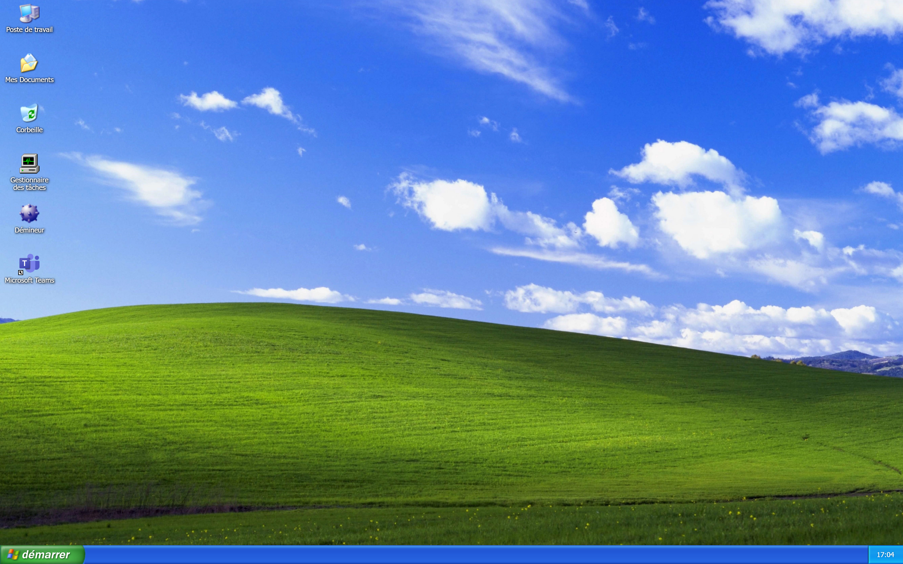

**Français** · [English](README.en.md)

# Mid-2000 PC

Un PC de 2004 sous Windows XP, reproduit dans le navigateur : le BIOS qui fait
son POST, l'écran de boot Windows XP, l'écran de bienvenue, puis un bureau
complet avec ses fenêtres, sa barre des tâches et son menu Démarrer.

**Démo en ligne : [https://mid-2000-pc.douay.me/](https://mid-2000-pc.douay.me/)**



## Fonctionnalités

- **Séquence de démarrage complète** : écran BIOS avec POST et test mémoire
  (beep inclus), écran de boot Windows XP, écran d'ouverture de session, écran
  de bienvenue avec le son de démarrage.
- **BIOS Setup** : accessible avec la touche `Suppr` pendant le POST, navigable
  au clavier.
- **Bureau Windows XP** : icônes, fond d'écran, barre des tâches, menu
  Démarrer, boîte de dialogue Exécuter, fenêtres déplaçables et
  redimensionnables (réduire / agrandir / fermer).
- **Explorateur** : Poste de travail, navigation dans les dossiers, plusieurs
  modes d'affichage, création / renommage / suppression / copier-coller, le
  tout sur un système de fichiers virtuel conservé dans le navigateur.
- **Bloc-notes** : ouverture et enregistrement des fichiers texte de ce
  système de fichiers.
- **Démineur** : le jeu culte, fidèle à l'original.
- **Gestionnaire des tâches** : applications, processus, performances, et
  icône animée dans la zone de notification.
- **Comptes d'utilisateurs** : création et modification des comptes proposés à
  l'ouverture de session.
- **Session et arrêt** : fermeture de session, arrêt et redémarrage (qui
  relance la séquence de boot).

Ce qui reste à faire et les limites connues sont listés dans
[ROADMAP.md](ROADMAP.md).

## Internationalisation

L'interface n'est **que partiellement bilingue**. L'infrastructure i18next est
en place (français et anglais, langue du navigateur détectée automatiquement,
anglais par défaut, pas de sélecteur de langue), mais seuls 8 fichiers `.tsx`
sur 79 passent par `useTranslation`.

- **Traduit (fr / en)** : les écrans de session (ouverture, bienvenue,
  fermeture, arrêt, extinction), le bouton Démarrer et l'horloge de la barre
  des tâches, le menu contextuel des boutons de la barre des tâches, le menu
  contextuel du bureau, les Comptes d'utilisateurs.
- **En français uniquement** : le menu Démarrer, les icônes du bureau,
  l'Explorateur, le Bloc-notes, le Gestionnaire des tâches, le Démineur, la
  boîte de dialogue Exécuter, la fenêtre d'arrêt de l'ordinateur.
- **En anglais uniquement**, comme sur une vraie machine : le BIOS, le BIOS
  Setup et l'écran bleu.

## Architecture

```
src/
├── App.tsx            machine à états du démarrage (BIOS → boot → session → bureau)
├── apps/              une application par dossier (Explorer, Notepad, TaskManager,
│                      UserAccounts, Minesweeper)
├── common/
│   ├── stores/        état global Zustand (fenêtres, applications, session, comptes...)
│   ├── fs/            système de fichiers virtuel et ses tests
│   ├── types/         types partagés (AppTemplate, WindowInfo)
│   └── i18n/          catalogues fr / en
├── components/        composants du shell : atoms, molecules, organisms, templates
└── i18n.ts            initialisation d'i18next
```

**Du démarrage au bureau.** `src/App.tsx` tient une machine à états
(`BootStage`) : `bios` → `windows-boot` → `logon` → `windows-splash-screen` →
`desktop`, plus `bios-setup`, `logoff`, `shutting-down`, `poweroff` et `bsod`.
Chaque écran est un composant de `src/components/templates/` ; ceux du
démarrage signalent leur fin par un callback. Les écrans BIOS, BIOS Setup, boot et écran bleu sont dessinés
sur un `<canvas>` 2D, mis à l'échelle de la fenêtre par
`src/components/wrapper/Display.tsx`. Les demandes venues du bureau (fermer la
session, arrêter, redémarrer, écran bleu) passent par
`src/common/stores/systemStore.ts`, que `App.tsx` observe ; le redémarrage
revient au BIOS sans recharger la page.

**Gestionnaire de fenêtres.** `src/common/stores/windowsStore.ts` détient la
liste des fenêtres (`WindowInfo` : position, taille, ordre d'empilement, état
réduit / agrandi, contenu React) et les actions qui la modifient : ouvrir,
fermer, mettre au premier plan, déplacer, redimensionner, réduire, agrandir.
Le bureau (`src/components/templates/Desktop/Desktop.tsx`) affiche une
`Window` par entrée ; la barre des tâches lit le même store.

**Modèle d'application.** Une application est un objet `AppTemplate`
(`src/common/types/appTemplate.ts`) : identifiant (`notepad.exe`), nom, icônes,
`multiInstance`, composant `MainWindow`, icône de zone de notification
facultative, et une fonction `init(pid)` qui ouvre la fenêtre et renvoie un
contrôleur (`killInstance`). `src/common/stores/appsStore.ts` lance les
applications (`startApp`), attribue les `pid` et garde la liste des instances,
sur laquelle s'appuie le Gestionnaire des tâches. Il n'existe pas encore de
registre central : le bureau, le menu Démarrer et la boîte Exécuter importent
chacun les applications qu'ils lancent.

**Système de fichiers virtuel.** `src/common/fs/` modélise le lecteur `C:`
comme un arbre de dossiers et de fichiers texte, avec une Corbeille. Le store
`useFsStore` expose une API proche d'un vrai système de fichiers (`stat`,
`readDir`, `readFile`, `writeFile`, `mkdir`, `rename`, `move`, `copy`,
`remove`...). Chaque modification est appliquée sur une copie puis enregistrée
dans le `localStorage` (clé `mid-2000-pc-fs-v1`) ; au premier lancement, une
arborescence initiale est créée. L'Explorateur et le Bloc-notes s'appuient
dessus. C'est la seule partie du projet couverte par des tests.

**Ce qui est conservé dans le navigateur.** Tout est local, dans le
`localStorage` : le système de fichiers, les comptes d'utilisateurs, la
position des icônes du bureau et les meilleurs temps du Démineur. Il n'y a ni
serveur ni compte en ligne.

## Stack technique

- [React 18](https://react.dev/) + [TypeScript](https://www.typescriptlang.org/)
- [Vite 6](https://vitejs.dev/)
- [Zustand](https://zustand-demo.pmnd.rs/) pour l'état global
- SCSS Modules
- [i18next](https://www.i18next.com/) / react-i18next (fr / en)
- Canvas 2D pour les écrans BIOS et de boot
- [Vitest](https://vitest.dev/) pour les tests

## Installation

```bash
# Installer les dépendances
npm install

# Lancer le serveur de développement
npm run dev

# Vérifier le code
npm run lint

# Vérifier les types
npm run typecheck

# Lancer les tests
npm run test

# Construire pour la production
npm run build

# Prévisualiser le build de production
npm run preview
```

## Crédits

- Développé par [Vincent Douay](https://douay.me).
- Le Démineur est l'œuvre de mon frère [Florian Douay](https://florian.douay.me).

## Disclaimer

Ce projet est un hommage nostalgique à Windows XP, réalisé pour le plaisir. Il
n'est **ni affilié à, ni sponsorisé, ni approuvé par Microsoft Corporation**.
Windows XP ainsi que ses éléments visuels et sonores (icônes, fond d'écran
Bliss, sons système, écrans de démarrage) sont des marques et des œuvres de
Microsoft Corporation, utilisés ici uniquement à titre d'hommage/parodie. Le
code source du projet est publié sous [licence MIT](LICENSE) ; les assets
évoquant Windows XP en sont exclus.
